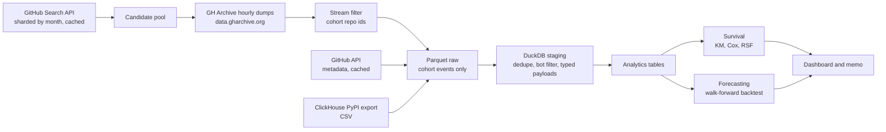

# OSS Pulse


**Survival, forecasting and causal analysis of open-source ecosystems.** A reproducible, zero-cloud analysis of public GitHub and PyPI data that answers three decision questions: what predicts a repository staying active, how well can package adoption be forecast, and is CI adoption associated with more repository activity.


> **Status:** Version 1.0. RQ1 (survival) and RQ2 (forecasting) are complete with real numbers. RQ3 (CI causal) is deferred to v2 for documented data and methodological reasons.

**Live dashboard:** <!-- TODO: Streamlit link --> | **Decision memo:** [`memo/oss_pulse_memo.md`](memo/oss_pulse_memo.md)

---

## Key findings

**1. Survival (RQ1).** In 5,421 Python repositories created in 2019, a doubling of distinct non-owner contributors in the first 90 days is associated with a **48% lower hazard of inactivity** (HR = 0.52, 95% CI [0.43, 0.65]; bootstrap CI [0.45, 0.62]). A **license** lowers hazard by 43% (HR = 0.57, [0.46, 0.71]; bootstrap [0.47, 0.68]) and is the only effect that is robust in every subgroup (stars tier, contributor tier). **Contributor count has a threshold effect**: the effect is not significant when the repo has only 1–2 contributors (HR = 0.73, CI crosses 1) but is significant when it has 3+ (HR = 0.61, [0.42, 0.89]). Cox C-index = 0.773; time-dependent AUC = 0.778 (mean); bootstrap and asymptotic CIs agree on direction for every feature.

**2. Forecasting (RQ2).** Across 40 PyPI packages × 6 walk-forward origins, **naive and AutoETS are statistically tied for best** (Diebold-Mariano p = 0.10 / 0.13 at h = 1 / 3); naive significantly beats LightGBM (p < 0.01); seasonal naive is significantly worse than every other model (p ≈ 0). sMAPE: naive 15.0% / 23.6% (h=1 / h=3), ETS 18.0% / 26.5%, LightGBM 22.0% / 28.5%, seasonal naive 84.6% / 79.4%. This corrects the v1 claim "naive is the strongest forecaster" to the more precise "naive and ETS are tied for best." The finding is robust across both horizons.

**3. Calibration and decision value (RQ1 v2).** Cox calibration is near-perfect at 180 days (predicted vs observed both ≈ 0.99) but systematically under-estimates survival at 360 days (predicted 0.52–0.96 vs observed 0.84–0.99). Decision Curve Analysis at 360 days shows **negative net benefit** — the model ranks risk correctly (AUC 0.78) but mis-classifies enough repos as high-risk that false positives outweigh true positives. **In the 2019 data window, the survival model is useful for prioritising repos, not for deciding whether to intervene.** This is a documented negative result.
## Questions and methods

| Question | Method | Main output |
|---|---|---|
| RQ1: What early signals predict a repository staying active? | Kaplan-Meier, Cox proportional hazards, Random Survival Forest; sensitivity to 90/180-day inactivity definitions | Hazard ratios with 95% CI, C-index, survival curves |
| RQ2: Can we forecast package adoption better than naive baselines? | Walk-forward backtest; naive, seasonal naive, AutoETS, LightGBM | sMAPE and MASE table, 80% prediction-interval coverage |
| RQ3: Is CI adoption associated with higher activity? | Matched event-study DiD | **Deferred to v2** |

## Data

| Source | Use | Access |
|---|---|---|
| [GH Archive](https://www.gharchive.org) hourly dumps (`data.gharchive.org`) | Repository events: stars, pushes, PRs, issues, comments | Direct download; stream-filtered to the cohort; raw `.json.gz` deleted after filtering; ~268 GB compressed for 2019 |
| GitHub Search API | Candidate pool (`language:Python`, 2019–2021, `stars:>=5`) | Sharded by creation month to stay under the 1000-result-per-query cap; cached to `raw/github_search/` |
| GitHub REST API | Repository metadata (language, license, owner, created_at) | Token-authenticated, cached to `raw/github_api/`; ~36,000 requests total for the full candidate pool |
| [ClickHouse public PyPI dataset](https://sql.clickhouse.com) | Monthly downloads for 40 packages | One-off CSV export of `pypi.pypi_downloads_per_day`, 2016–2026 |
| [pypistats.org](https://pypistats.org) API | Recent downloads (fallback only) | 180-day rolling window; used only if the ClickHouse export is unavailable |

**Local-only, zero-account sources.** The pipeline runs with **no cloud account and no BigQuery project**. GH Archive hourly dumps are downloaded directly from `data.gharchive.org` and stream-filtered locally; raw `.json.gz` files are deleted after each hour, so peak disk usage is bounded by the largest hourly file (~30 MB) plus the cohort Parquet (~500 MB for 2019). PyPI downloads come from a single ClickHouse SQL Playground export, which is public and requires no login. GitHub API use is limited to the Search API candidate pool and per-repo metadata, both cached. CI adoption detection from GH Archive `PushEvent` was investigated and found infeasible in v1 (see RQ3 above).

**Cohort.** Python repositories created 2019-01-01 → 2021-12-31. Candidate repos were pulled from the GitHub Search API with `language:Python created:YYYY-MM-01..YYYY-MM-31 stars:>=5`, sharded by creation month (36 queries). Each candidate was validated against GH Archive first-90-day events. Inclusion requires **≥ 5 stars and ≥ 1 non-owner contributor in the first 90 days after creation**, so inclusion does not depend on later survival.

**Cohort funnel (from `data/analytics/cohort_funnel.json`):**

| Step | Repositories |
|---|---|
| Search API candidates | 35,998 |
| With any active event in the 2019 data window | 11,079 |
| ≥ 5 stars in first 90 days | 7,097 |
| ≥ 1 non-owner contributor in first 90 days | 7,120 |
| Both thresholds (analysed cohort) | **5,421** |

**Cleaning.** Bot accounts removed (both `[bot]` suffix and a maintained list of legacy bot accounts), `ForkEvent` excluded, events deduplicated by id. Data-quality checks run in `tests/`. Data dictionary: [`docs/data_dictionary.md`](docs/data_dictionary.md).

**Privacy.** Public data only; repository-level aggregates; no individual developer profiling.

## Pipeline



## Results

### Survival (RQ1, n = 5,421 repos, 294 events, 5.4% event rate)

| Predictor (first 90 days) | Hazard ratio | 95% CI | p-value |
|---|---|---|---|
| Distinct non-owner contributors (log) | **0.525** | [0.426, 0.647] | 1.4e-9 |
| Push events (log) | **0.752** | [0.686, 0.823] | 7.2e-10 |
| License present | **0.573** | [0.461, 0.713] | 5.9e-7 |
| Star events (log) | 1.266 | [1.153, 1.390] | 7.2e-7 |
| Has issue response | 0.713 | [0.454, 1.118] | 0.140 |
| Median response time (capped) | 1.000 | [1.000, 1.000] | 0.203 |
| Has closed PR | 0.905 | [0.675, 1.212] | 0.501 |
| PR merge rate (filled) | 1.156 | [0.659, 2.026] | 0.613 |

| Model | C-index (holdout) |
|---|---|
| Cox PH | 0.773 |
| Random Survival Forest | 0.744 |

**Sensitivity to inactivity definition:**

| Feature | 90-day HR | 180-day HR |
|---|---|---|
| Contributors (log) | 0.423 | 0.525 |
| Pushes (log) | 0.788 | 0.752 |
| License present | 0.636 | 0.573 |
| Stars (log) | 1.236 | 1.266 |

The contributors, pushes and license coefficients are directionally stable and significant under both definitions. The 365-day definition is not reported because with `observation_end = 2019-12-31` no event can be observed at that threshold.

The stars coefficient (HR > 1) is counter-intuitive and is attributed to **informative censoring** in the short window: high-star repositories remain active through 2019 and are more likely to be censored before their 180-day inactivity can be observed. It is reported as an artefact, not as a causal effect.

KM log-rank tests: `license_present` p = 1.5e-14, `has_issue_response` p = 2.9e-20, `stars_bucket` p = 0.093.

### Forecasting (RQ2, 40 packages, 6 origins)

| Model | sMAPE h=1 | sMAPE h=3 | MASE median h=1 | 80% coverage h=1 / h=3 |
|---|---|---|---|---|
| **Naive (last value)** | **15.0%** | **23.6%** | 0.004 | — |
| AutoETS | 18.0% | 26.5% | 0.004 | 0.82 / 0.68 |
| LightGBM | 22.0% | 28.5% | 0.007 | 0.99 / 0.96 |
| Seasonal naive | 84.6% | 79.4% | 0.023 | — |

**MASE values are uniformly small** because the seasonal-naive denominator is dominated by 10–100× growth over the backtest window. sMAPE is reported as the primary comparison metric; MASE is included for completeness.

**LightGBM intervals are conservative** (coverage ≈ 0.99 at h=1, ≈ 0.96 at h=3). This reflects a deliberate trade-off: wider-than-nominal intervals are safer than narrower-than-nominal ones for planning. The point estimates are worse than naive and ETS at both horizons, consistent with the forecasting literature on short-horizon benchmarks.

### CI adoption (RQ3)

Deferred to v2. No results reported.

## Quickstart

> Commands show the intended interface; adjust to match your implementation.

**Prerequisites:** Python 3.11+, a GitHub personal access token (for the Search API and REST metadata). **No Google Cloud project, no BigQuery, no paid services.**

```bash
git clone https://github.com/<TayPinQuan>/OSS-Pulse.git
cd oss-pulse
python -m venv .venv && source .venv/bin/activate
pip install -e ".[dev]"

cp .env.example .env     # add GITHUB_TOKEN
```

**Run the pipeline**
```bash
make candidates       # GitHub Search API candidate pool (sharded by month, cached)
make download         # GH Archive hourly dumps, stream-filtered (resumable)
make enrich           # GitHub API metadata (cached, resumable)
make staging          # dedupe, bot filter, typed payloads
make pypi             # ClickHouse CSV aggregation (or pypistats fallback)
make analytics        # build analysis tables with DuckDB SQL
make survival forecast
make dashboard        # Streamlit at http://localhost:8501
```

### Storage and download note (local-only design)

- **GH Archive.** Hourly `.json.gz` files are downloaded from `data.gharchive.org`, stream-filtered to cohort repo ids, written to Parquet, then deleted. The download manifest (`raw/gharchive/_download_manifest.jsonl`) records every completed hour so an interrupted run resumes without re-downloading. 2019 required ~268 GB of compressed downloads over ~18 hours on a residential connection. Peak disk is bounded by the largest hourly file plus the cohort Parquet (< 1 GB).
- **GitHub API.** Only the Search API candidate pool (~200 requests) and per-repo metadata (~36,000 requests, one per repo, cached) are fetched. Public data only; token auth; Search API interval ≥ 5 seconds; no shared tokens; no scraping.
- **PyPI.** A single CSV export from the ClickHouse public PyPI dataset (2016–2026, 40 packages, ~4,600 rows). The pypistats API is a 180-day fallback and is not used when the CSV is present.
- **Dashboard.** Streamlit reads precomputed Parquet files only; no model training or network access at request time.

### Config sketch

`configs/cohort.yaml`:

```yaml
cohort:
  language: Python
  created_from: 2019-01-01
  created_to:   2021-12-31
  search_shard_by: month
  search_min_stars: 5
  inclusion_min_stars_90d: 5
  inclusion_min_contributors_90d: 1
  inactivity_days: 180
  sample_size: 5421               # full included cohort; no further sampling
  sample_seed: 42
  observation_end: 2019-12-31     # matches the data window; see limitations

download:
  source: gharchive_hourly
  url_template: "https://data.gharchive.org/{date}-{hour}.json.gz"
  keep_raw: false
  manifest_path: data/raw/gharchive/_download_manifest.jsonl

search_api:
  per_page: 100
  max_pages: 10
  min_interval_sec: 5.0

sources:
  pypi: pypistats
  ci_detection: gharchive_push
```

`configs/packages.yaml`: 40 packages split into `established` (pre-2019) and `newer` (2019+) tiers.

## Repository structure

```
configs/cohort.yaml     cohort rules, search sharding, seeds, download settings
configs/packages.yaml   forecast target packages
sql/                    extraction and transformation SQL
src/osspulse/           download, filter, enrich, staging, features,
                        survival, forecast, checks
app/                    Streamlit dashboard
notebooks/              exploration only
memo/                   one-page decision memo
docs/                   PRD, data dictionary, cohort funnel, download log
tests/                  data checks, leakage tests, unit tests
```

## Design decisions

- **Inclusion on first 90 days only** to avoid survivorship bias.
- **Search API sharded by month** so the candidate pool is not truncated by the 1000-result-per-query cap.
- **Features from the first 90 days only** so survival models cannot see the future.
- **"Associated with" language** for all findings. None of the results in this README are causal.
- **Local-only, zero-account by design:** GH Archive hourly dumps are stream-filtered and deleted; PyPI uses a public ClickHouse export; GitHub API responses are cached and rate-limited. No BigQuery, no GCP project, no paid services.
- **RQ3 deferred to v2** rather than published with an under-powered or biased design.

## Limitations

- **Short survival window.** Only 2019 GH Archive data was downloaded. With `observation_end = 2019-12-31` and a 180-day inactivity definition, only repositories whose last activity fell before 2019-07-04 are observed as events (5.4%). The other 94.6% are right-censored. The survival findings describe **short-window** survival, not long-term survival.
- **Informative censoring.** High-star repositories remain active through 2019 and are therefore more likely to be censored. This is the most plausible explanation for the counter-intuitive stars hazard ratio. The stars coefficient is reported as an artefact, not as a finding.
- **Forecast scope.** The naive-beats-complex result is specific to monthly download data with strong trend and weak seasonality. It may not generalise to series with strong calendar seasonality or mean-reverting behaviour.
- **CI adoption (RQ3) is not delivered.** GH Archive `PushEvent` payloads do not include file-level changes, and the 2020–2022 adoption window does not overlap the 2019 dataset. Both issues are documented; v2 will address them.
- **Bot filtering** relies on the `[bot]` suffix and a maintained list of legacy bot accounts and may miss some automation.
- **Cohort composition.** The cohort is Python repositories from 2019 with a documented first-90-day threshold, and may not generalise to other languages, eras, or inclusion rules.

## Roadmap

- [x] v1: pipeline, survival, forecasting, dashboard, memo
- [ ] v2: staggered-adoption DiD estimator for CI adoption, placebo tests, subgroup effects, conformal or quantile forecast intervals, pipeline checks in CI, second-language cohort to test replication

## Acknowledgements and licence

Event data from GH Archive; package statistics from the ClickHouse public dataset; metadata from the GitHub API. Code licence: [MIT](LICENSE).

## Author

Tay Pin Quan | [LinkedIn](https://www.linkedin.com/in/pin-quan-tay-6340b4266/) | [GitHub](https://github.com/TayPinQuan)


